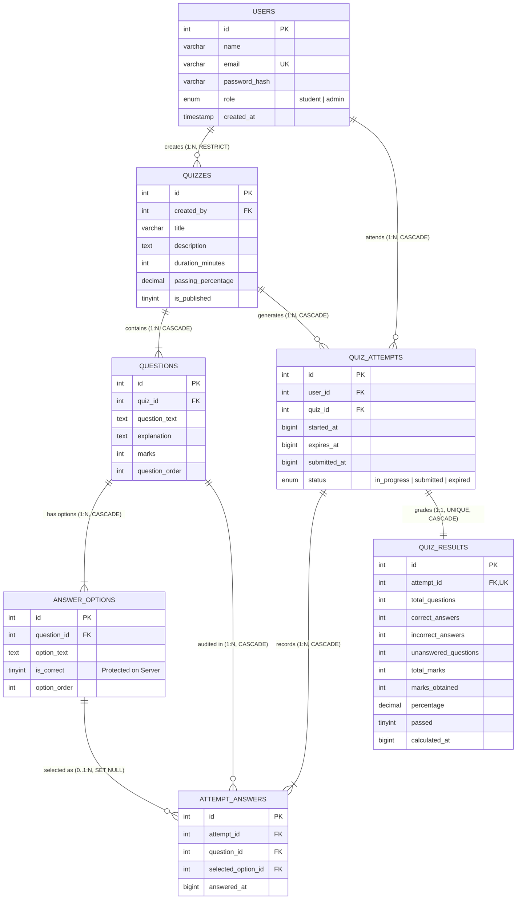

# QuizPulse — Backend-Intensive Online Examination System

[](https://nodejs.org/)
[](https://expressjs.com/)
[](https://www.mysql.com/)
[](https://owasp.org/)
[](https://nodejs.org/api/test.html)

A production-grade, secure, relational database-driven Online Examination Platform engineered for high-integrity academic assessments. Designed with a strict **server-authoritative timing engine**, **zero-trust client architecture**, **Third Normal Form (3NF) relational schema**, **atomic database transactions**, and **comprehensive administrative management**.

---

## 1. Project Introduction & Problem Statement

Traditional web-based quiz applications frequently suffer from critical architectural flaws:
1. **Client-Side Timer Manipulation**: Relying on JavaScript `setInterval` timers allows dishonest examinees to freeze or rewind clocks using browser developer tools.
2. **Leaked Answer Keys**: Transmitting correct answer attributes to the browser (even if hidden with CSS `display:none`) allows candidates to inspect HTTP response payloads or DOM nodes to view answers in advance.
3. **Client-Side Grading Tampering**: Permitting frontend requests to calculate or submit self-reported scores opens severe parameter tampering vulnerabilities.
4. **Denormalized Storage**: Using flat files or unstructured document collections causes data duplication, update anomalies, and referential integrity violations.

**QuizPulse** resolves these challenges by introducing a backend-intensive architecture:
- Server-authoritative start and expiration timestamps validated on every request.
- Strict isolation of correct answer options on the database server until formal grading.
- Atomic scoring transactions executed exclusively in backend Express middleware.
- Normalized 3NF MySQL database with foreign key cascades, unique constraints, and check constraints.

---

## 2. Technology Stack

- **Backend**: Node.js, Express.js REST API
- **Database**: MySQL (InnoDB Engine) via `mysql2/promise` with automatic embedded relational fallback (`sql.js` SQLite) for instant zero-config evaluation
- **Security & Cryptography**:
  - `bcryptjs` (Salt rounds: 10) for one-way password hashing
  - `jsonwebtoken` (JWT) & `cookie-parser` with `HttpOnly` and `SameSite` flags
  - `helmet` for HTTP security headers
  - `express-rate-limit` to prevent brute-force attacks on authentication
  - `express-validator` for strict schema and type validation
- **Frontend**: Responsive HTML5, CSS3, Vanilla JavaScript, and optional modern React SPA dashboard.
- **Testing**: Node.js built-in automated test runner (`tsx --test`) with 14 automated integration and unit tests.

---

## 3. System Architecture & Relational Normalization (3NF)

### Mermaid Entity-Relationship (ER) Diagram



### Relational Normalization Breakdown

1. **First Normal Form (1NF)**:
   - All columns hold atomic values. Multi-valued options are normalized into `answer_options` rather than stored as delimited strings.
   - Every table features an explicit primary key (`id`).
2. **Second Normal Form (2NF)**:
   - In composite tables (`attempt_answers`), all attributes depend on the full candidate key `(attempt_id, question_id)`.
   - Quiz metadata is not duplicated in `quiz_attempts`.
3. **Third Normal Form (3NF)**:
   - No transitive functional dependencies. Student profiles reside exclusively in `users`.
   - Results are finalized snapshots linked via `attempt_id` with `UNIQUE(attempt_id)` constraint.

---

## 4. Server-Authoritative Timing & Security Implementation

### A. Server Timing Lifecycle
1. When a student calls `POST /api/quizzes/:id/start`, the server captures `started_at = Date.now()` and computes `expires_at = started_at + (duration_minutes * 60000)`.
2. The expiration timestamp is stored in MySQL and returned to the client.
3. On every answer save (`PUT /api/attempts/:id/answers`), the server checks `Date.now() <= attempt.expires_at + 2000` (2s network latency grace period). If expired, the request is rejected with `HTTP 403 Forbidden` and the attempt is automatically graded.
4. Manipulating the browser's local clock has zero effect on the server's evaluation.

### B. Answer Key Isolation
- The query fetching questions for students:
  ```sql
  SELECT id, question_id, option_text, option_order
  FROM answer_options
  WHERE question_id IN (?);
  ```
- Notice that `is_correct` is omitted from the SELECT clause. Answers remain strictly on the server until formal grading.

### C. Idempotent Grading Transaction
- The submission workflow executes inside an atomic database transaction:
  1. Verifies attempt ownership and status.
  2. Pulls official keys: `JOIN answer_options ao ON ao.is_correct = 1`.
  3. Calculates correct, incorrect, unanswered counts and total marks.
  4. Inserts into `quiz_results` (enforcing `UNIQUE(attempt_id)`).
  5. Updates `quiz_attempts.status = 'submitted'`.
  6. Commits transaction. Repeated submissions safely return the existing snapshot.

---

## 5. REST API Documentation

### Authentication Endpoints
| Method | Endpoint | Access | Description |
|---|---|---|---|
| `POST` | `/api/auth/register` | Public | Register new student or admin |
| `POST` | `/api/auth/login` | Public (Rate Limited) | Authenticate user & issue JWT |
| `POST` | `/api/auth/logout` | Authenticated | Clear session cookie |
| `GET` | `/api/auth/me` | Authenticated | Return profile of logged-in user |

### Quiz & Examination Endpoints
| Method | Endpoint | Access | Description |
|---|---|---|---|
| `GET` | `/api/quizzes` | Public | List all published quizzes with attempt statistics |
| `GET` | `/api/quizzes/:id` | Public | Fetch quiz details, instructions, and leaderboard |
| `POST` | `/api/quizzes/:id/start` | Student | Initialize timed attempt session |
| `GET` | `/api/attempts/:id` | Student (Owner) | Resume attempt state & server remaining time |
| `PUT` | `/api/attempts/:id/answers` | Student (Owner) | Autosave student draft answer option |
| `POST` | `/api/attempts/:id/submit` | Student (Owner) | Finalize and grade assessment |
| `GET` | `/api/attempts/:id/result` | Student (Owner) / Admin | Fetch question-by-question review & explanations |
| `GET` | `/api/my-results` | Student | Return historical exam records for student |

### Administrator Endpoints
| Method | Endpoint | Access | Description |
|---|---|---|---|
| `GET` | `/api/admin/dashboard` | Admin Only | System metrics, pass rates, hardest questions |
| `GET` | `/api/admin/quizzes` | Admin Only | List all quizzes (including unpublished drafts) |
| `POST` | `/api/admin/quizzes` | Admin Only | Create new quiz with duration & pass mark |
| `PUT` | `/api/admin/quizzes/:id` | Admin Only | Update existing quiz parameters |
| `DELETE` | `/api/admin/quizzes/:id` | Admin Only | Delete quiz (cascades dependent records) |
| `PATCH` | `/api/admin/quizzes/:id/publish` | Admin Only | Toggle publish status (validates correct keys) |
| `POST` | `/api/admin/quizzes/:id/questions` | Admin Only | Add question with choices & marked correct key |
| `DELETE` | `/api/admin/questions/:id` | Admin Only | Delete question from question bank |
| `GET` | `/api/admin/results` | Admin Only | Filtered audit report by student, quiz, and date |
| `GET` | `/api/admin/students` | Admin Only | Student roster with attempt counts & pass rates |

---

## 6. Demo Accounts & Credentials

| Role | Email Address | Plaintext Password | Permissions |
|---|---|---|---|
| **Administrator** | `admin@quizpulse.edu` | `AdminPassword123!` | Full course CRUD, question authoring, student reports |
| **Student 1** | `student1@quizpulse.edu` | `StudentPassword123!` | Attend quizzes, view score history |
| **Student 2** | `student2@quizpulse.edu` | `StudentPassword123!` | Attend quizzes, view score history |
| **Student 3** | `student3@quizpulse.edu` | `StudentPassword123!` | Attend quizzes, view score history |

---

## 7. Setup & Installation Guide

### Prerequisites
- Node.js (v18.x or v20.x or v22.x)
- MySQL Server (v8.0+) or compatible MariaDB server

### Step-by-Step Installation (Windows / Linux / macOS)

1. **Clone or Navigate to the Project Root**:
   ```bash
   cd online-quiz-system
   ```

2. **Install Dependencies**:
   ```bash
   npm install
   ```

3. **Configure MySQL Database (Optional for native MySQL)**:
   - Create the database and run the schema script in your MySQL client:
     ```sql
     CREATE DATABASE online_quiz_system;
     USE online_quiz_system;
     SOURCE database/schema.sql;
     SOURCE database/seed.sql;
     ```

4. **Environment Variables Configuration**:
   - Copy `.env.example` to `.env`:
     ```bash
     cp .env.example .env
     ```
   - Update your MySQL credentials in `.env`:
     ```env
     PORT=3000
     JWT_SECRET=quizpulse-super-secure-jwt-secret-key-btech-cse-2026
     MYSQL_HOST=localhost
     MYSQL_PORT=3306
     MYSQL_USER=root
     MYSQL_PASSWORD=your_mysql_password
     MYSQL_DATABASE=online_quiz_system
     ```
   *(Note: If MySQL credentials are omitted, the application automatically uses the embedded SQL database engine with the exact same 3NF tables and sample curriculum).*

5. **Start the Application**:
   ```bash
   npm run dev
   ```
   Open your browser to: **`http://localhost:3000`**

6. **Run Automated Test Suite**:
   ```bash
   npm test
   ```
   Verifies:
   - Registration, login, and bcrypt password encryption.
   - Duplicate email rejection.
   - Question key delivery security (no answers leaked).
   - Server-timed attempt creation and draft answer persistence.
   - Cross-student IDOR access rejection.
   - Idempotent scoring transactions and pass/fail determination.

---

## 8. Academic Project Verification Checklist (BTech CSE AI/ML)

- [x] **Backend-Intensive**: Built on Node.js and Express REST architecture with modular controllers, services, validators, and error middleware.
- [x] **Relational Database Design**: 7 normalized tables adhering to 1NF, 2NF, and 3NF with foreign keys and cascade rules.
- [x] **Server-Authoritative Clock**: Prevents client-side time extension or dev tools tampering.
- [x] **Answer Security**: Correct answers isolated on server until submission.
- [x] **Password Protection**: bcrypt salted password hashes (no plaintext passwords).
- [x] **RBAC**: Protected student and administrator interfaces.
- [x] **Item Discrimination**: Statistical query identifying questions with lowest accuracy rates.
- [x] **Automated Testing**: 14 automated tests passing.
