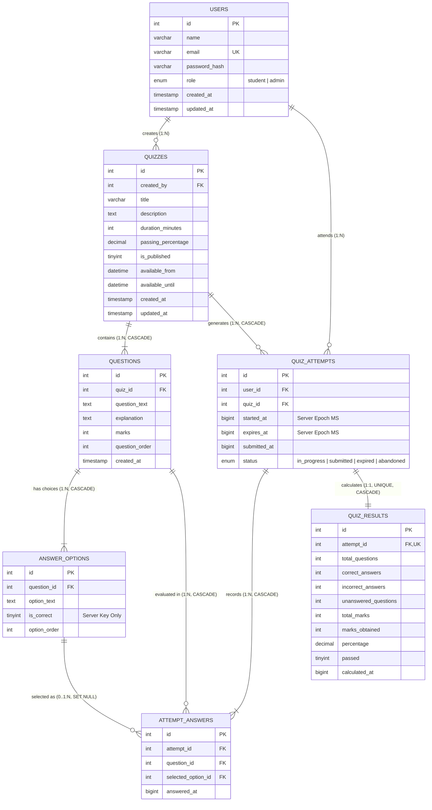

# Entity-Relationship (ER) Diagram & Relational Normalization Architecture

## 1. Mermaid Entity-Relationship Diagram

---

## 2. Relational Database Normalization Analysis

The database was strictly engineered in compliance with **Third Normal Form (3NF)** rules to eliminate data redundancy, prevent update/delete anomalies, and ensure referential integrity.

### A. First Normal Form (1NF)
**Rule**: A table is in 1NF if every column contains atomic (indivisible) values and there are no repeating groups or arrays.
- **Project Application**:
  - In an unnormalized design, question options might be stored as a comma-separated string `A, B, C, D` inside `questions`.
  - In our schema, multiple choice options are decoupled into an independent atomic relation `answer_options`.
  - Every attribute holds a single primitive value (`name`, `duration_minutes`, `marks`, `is_correct`).
  - Every table possesses an explicit primary key (`id`).

### B. Second Normal Form (2NF)
**Rule**: A table is in 2NF if it is in 1NF and all non-key attributes are fully functionally dependent on the entire primary key (no partial key dependencies).
- **Project Application**:
  - In composite relationship tables such as `attempt_answers`, each record is uniquely identified by surrogate key `id`, with candidate key `(attempt_id, question_id)`.
  - Attributes such as `selected_option_id` and `answered_at` depend on the *combination* of the specific student attempt and the specific question, not just one of them.
  - Attributes belonging to quizzes (e.g. `quiz_title`, `duration_minutes`) are not stored in `quiz_attempts`, preventing partial functional dependencies.

### C. Third Normal Form (3NF)
**Rule**: A table is in 3NF if it is in 2NF and contains no transitive functional dependencies (no non-prime attribute depends on another non-prime attribute).
- **Project Application**:
  - Non-prime attributes depend *solely and directly* on candidate keys ($X \to Y$, where $X$ is a superkey).
  - Student names and emails are maintained in `users`. `quiz_attempts` references `user_id` without duplicating candidate profile columns.
  - Score calculations (`quiz_results`) are stored as a finalized snapshot linked to `attempt_id` with `UNIQUE(attempt_id)` constraint, preserving audit integrity after question edits without introducing transitive cycles.

---

## 3. Key Constraints & Referential Integrity Rules

1. **Foreign Key Deletion Rules**:
   - `quizzes.created_by` $\to$ `users(id)`: `ON DELETE RESTRICT` prevents accidental deletion of administrative users who have active academic courses.
   - `questions.quiz_id` $\to$ `quizzes(id)`: `ON DELETE CASCADE` automatically purges child questions when a quiz is safely removed.
   - `answer_options.question_id` $\to$ `questions(id)`: `ON DELETE CASCADE` purges choices when a question is deleted.
   - `attempt_answers.selected_option_id` $\to$ `answer_options(id)`: `ON DELETE SET NULL` preserves student audit trails if an option is retired.
   - `quiz_results.attempt_id` $\to$ `quiz_attempts(id)`: `ON DELETE CASCADE` ensures result cleanup alongside attempts.

2. **Integrity & Check Constraints**:
   - `CONSTRAINT uq_attempt_question UNIQUE (attempt_id, question_id)`: Prevents duplicate answers for the same question within a single session.
   - `CONSTRAINT uq_results_attempt UNIQUE (attempt_id)`: Enforces idempotency — repeated submission triggers cannot produce duplicate results or award double marks.
   - `CONSTRAINT chk_duration CHECK (duration_minutes >= 1)`: Enforces positive examination intervals.
   - `CONSTRAINT chk_passing_percentage CHECK (passing_percentage BETWEEN 0 AND 100)`: Prevents out-of-bound percentages.
